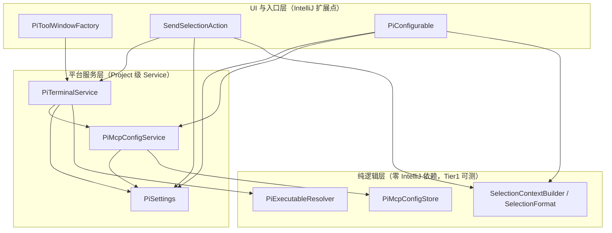
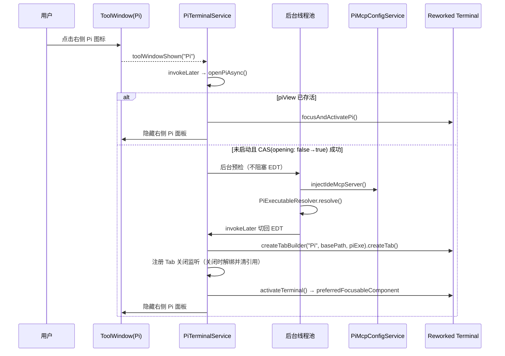

# 架构说明

> 核对：2026-11-20 0.2.4

本文档描述 MypiPlugin 的模块分层、依赖方向、核心流程、线程/并发边界与平台兼容约束。术语定义见 [领域词汇表.md](领域词汇表.md)，关键设计取舍见 [架构决策记录](README.md#架构决策记录adr)。

## 分层与依赖方向

代码位于 `src/main/kotlin/com/mypi/plugin/`，按「平台交互层 → 零依赖纯逻辑层」单向依赖组织：

### 各模块职责边界

| 层级 | 文件 | 职责边界 |
|---|---|---|
| 入口层 | `PiToolWindowFactory.kt` | 创建右侧 `Pi` 工具窗极简状态 `JLabel`，触发 `PiTerminalService` 初始化并订阅状态回调。 |
| 入口层 | `SendSelectionAction.kt` | 绑定 `Ctrl+Alt+;` 与菜单入口；解析相对/规范化路径、调用 `SelectionContextBuilder` 构造定位串、经 `PiTerminalService.inject()` 注入并按 `InjectResult` 处理焦点或提示。 |
| 入口层 | `PiConfigurable.kt` | `Settings → Tools → Pi` 配置页；读写 `PiSettings`，从启用切换为禁用 MCP 时同步调用 `PiMcpConfigService.removeIdeMcpServer()`。 |
| 服务层 | `PiTerminalService.kt` | 管理单会话 Pi 终端生命周期、监听 `ToolWindowManagerListener.toolWindowShown`、后台预检编排、Tab 关闭监听与解绑、焦点接力、只填不发送注入。 |
| 服务层 | `PiMcpConfigService.kt` | 读取开关、反射访问 IDEA MCP Server 获取 SSE URL、性能计时日志、持有用户级 `mcp.json` 全局写锁并委托 `PiMcpConfigStore` 落盘。 |
| 服务层 | `PiSettings.kt` | Project 级 `PersistentStateComponent`（存储于 `pi-settings.xml`），以 `@Volatile` 字段保证跨线程可见性。 |
| 纯逻辑层 | `SelectionContextBuilder.kt` | `SelectionFormat` 持久化解析/回退、整行选中末尾换行行号修正（`resolveLineRange`）、定位串格式化。 |
| 纯逻辑层 | `PiExecutableResolver.kt` | 自定义路径优先校验（仅接受可执行普通文件，过滤目录）与跨平台 `PATH` 扫描（Windows 顺序：`.exe` > `.cmd` > `.bat` > `pi`）。 |
| 纯逻辑层 | `PiMcpConfigStore.kt` | `mcp.json` 原子写入与降级、损坏 JSON 保护、移除 `intellij` 条目、`claude-code` 去重与 `host:port` 规范化提取。 |

## 核心工作流

### 1. 启动与重启 Pi 终端

### 2. 选区/光标注入与焦点接力

1. `SendSelectionAction.update()`：只要当前上下文存在 `EDITOR` 即启用（无选区也允许发送光标行）。
2. `resolvePath()`：项目内本地文件经 `VfsUtilCore.getRelativePath` 转为 `/` 分隔相对路径；项目外本地文件转为 `/` 规范化绝对路径；非本地虚拟文件（如 `jar://`）原样保留。
3. 行号计算：有选区时经 `SelectionContextBuilder.resolveLineRange()` 处理整行选中末尾换行边界（结束偏移落于下一行第 0 列时回退 1 行）；无选区时取光标行。
4. `PiTerminalService.inject()`：通过 `TerminalView.createSendTextBuilder().useBracketedPasteMode().sendEndKeyBeforeText().send(text)` 只填不发送；返回 `InjectResult.Success` 后执行 `focusAndActivatePi()`，失败或未开启时弹框提示。

### 3. IDE MCP 注入与清理

详见 [ADR-0002](架构决策/0002-反射集成IDE-MCP与全局写锁原子落盘.md)：
- 仅在新建 Pi 终端前执行（运行中修改配置不生效）。
- 写入前校验现有 `mcp.json`：损坏或非 JSON Object 时显式抛错返回 `Failed`，绝不静默清空用户已有配置。
- 关闭 MCP 开关时主动移除 `intellij` 条目，避免残留失效端口。

## 线程、并发与生命周期约束

| 边界 | 约束与机制 |
|---|---|
| **EDT 约束** | `TerminalToolWindowTabsManager.createTabBuilder()` / `createTab()` 与 UI 更新仅在 EDT 执行；`openPiAsync` 入口非 EDT 时自动 `invokeLater` 切回。 |
| **后台预检** | MCP 反射、去重文件读取、`mcp.json` 落盘与 `PATH` 扫描全部在 `executeOnPooledThread` 执行，避免卡顿 UI。 |
| **并发防重入** | `opening: AtomicBoolean` CAS 阻止连点重复建 Tab；后台回调回 EDT 后再次检查 `project.isDisposed` 与 `piView != null`。 |
| **资源清理** | `PiTerminalService.dispose()` 取消 `openingTask`、解绑 `ContentManagerListener` 并尝试关闭终端 Tab；Tab 手动关闭时亦立即解绑自身监听器，防止反复开关累积泄漏。 |
| **跨项目文件写锁** | `PiMcpConfigService` 虽为 Project 级服务，但操作用户级 `~/.pi/agent/mcp.json`，因此使用 companion 级全局 `lock` 保护读-改-写临界区，反射与去重读取在锁外执行。 |

## 平台依赖与降级策略

- **必需依赖**：`com.intellij.modules.platform`、`org.jetbrains.plugins.terminal`（2026.2+ Reworked Terminal API）。所有实验性终端调用均用 `runCatching` 包裹并回传可读状态，不让插件崩溃。
- **可选依赖**：`com.intellij.mcpServer`（`optional="true"`）。通过反射调用 `McpServerConnectionAddressProvider#getServerSseUrl`，低版本或禁用 MCP 插件时自动降级跳过。
- **配置持久化兼容**：`PiSettings.selectionFormat` 默认存空串（等价 `COLON_LINE`），仅选 GitHub 风格时存 `"GITHUB_ANCHOR"`，保障老版本 `pi-settings.xml` 平滑兼容。
